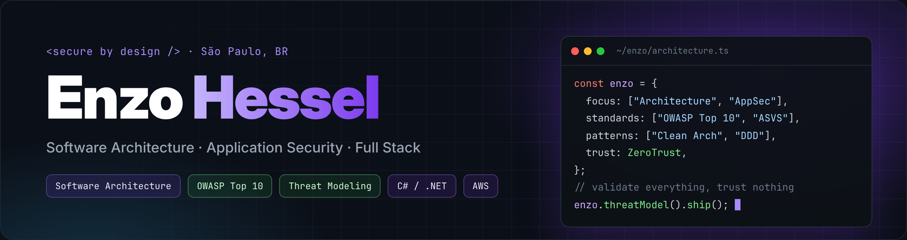

<div align="center">



[](https://git.io/typing-svg)

</div>

## 🎯 About Me

<table>
<tr>
<td width="55%" valign="top">

```javascript
const enzo = {
  role: "Full Stack Developer → Software Architecture & AppSec",
  location: "São Paulo, Brazil 🇧🇷",
  education: "MBA in Software Engineering",

  focus: [
    "Software Architecture & System Design",
    "Application Security (AppSec)",
    "Secure SDLC / DevSecOps",
  ],

  security: {
    standards: ["OWASP Top 10", "OWASP ASVS", "API Security Top 10"],
    practices: ["Threat Modeling (STRIDE)", "Secure Code Review",
                "SAST / DAST", "AuthN & AuthZ (OAuth2, OIDC, JWT)"],
  },

  architecture: ["Clean Architecture", "DDD", "Microservices",
                 "Event-Driven", "Cloud-Native (AWS)"],

  tech: {
    backend: ["C#", ".NET", "ASP.NET Core", "Node.js"],
    frontend: ["React", "Next.js", "TypeScript"],
    infra: ["AWS", "Docker", "GitHub Actions", "Terraform"],
  },
};
```

> *"Security is not a feature, it's an architectural decision."*

</td>
<td width="45%" align="center" valign="middle">


</td>
</tr>
</table>

## 🛡️ Architecture & AppSec

<table>
<tr>
<td width="50%" valign="top">

### 🏗️ Software Architecture

- Clean Architecture, Hexagonal & **DDD**
- Microservices, modular monoliths & event-driven systems
- System Design, scalability & resilience
- Architecture decision records (ADRs) & trade-off analysis
- Cloud-native architecture on **AWS**

</td>
<td width="50%" valign="top">

### 🔐 Application Security

- **OWASP Top 10** & **OWASP API Security Top 10**
- **OWASP ASVS** as a security requirements baseline
- Threat Modeling (**STRIDE**) from the design phase
- Secure code review, SAST / DAST / SCA in CI/CD
- AuthN & AuthZ: OAuth2, OpenID Connect, JWT

</td>
</tr>
</table>

<div align="center">


</div>

## 📫 Connect With Me

<div align="center">

<a href="https://www.linkedin.com/in/enzo-hessel/" target="_blank"></a>
<a href="https://www.instagram.com/me.hessel/" target="_blank"></a>
<a href="https://github.com/EnzoHessel" target="_blank"></a>

</div>

## 🛠️ Tech Stack

<div align="center">


<br/>

<br/>


<br/><br/>


</div>

## 📊 GitHub Analytics

<div align="center">


</div>

## 🔥 GitHub Streak

<div align="center">


</div>

